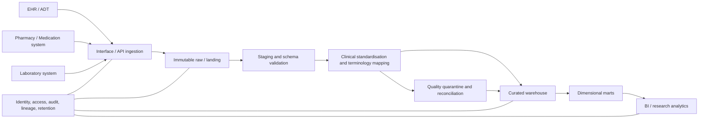

# Healthcare analytics warehouse architecture

## Design decisions
- Operational systems are optimised for care delivery and transactions; analytics workloads should not overload them.
- Preserve immutable source payloads under governed retention and access rules.
- Record source system, source resource/message ID, version, ingestion timestamp and transformation version.
- Separate structural validation from semantic clinical validation.
- Maintain an explicit quarantine/review path; do not silently discard invalid records.
- Define fact-table grain before joining: encounter, medication request/order and observation are separate grains.
- Use conformed patient, date, department and terminology dimensions where appropriate.
- Apply least privilege, audit logging and approved retention policies at each layer.
- Reconcile source, staged, quarantined and curated counts for each pipeline run.
